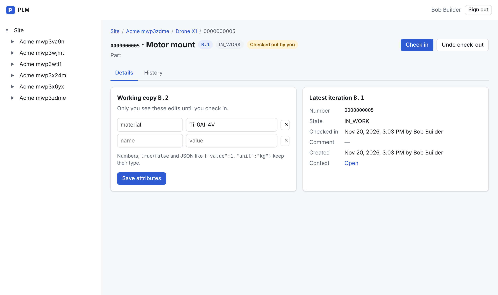

# PLM Platform

An open Product Lifecycle Management (PLM) platform: documents, parts, multi-level BOMs,
lifecycles, workflows and change management, built to scale to millions of objects.

> Status: **Phase 7 complete**: configuration: effectivity by date, serial, lot or block on
> versions and structure lines (end items, pending effectivity set through change notices, "as
> effective" structures), option sets with rules, 150% structures with choice conditions, variant
> specifications and variant generation with reuse, one-off versions for single orders, and
> classification with inherited class attributes, class search and find similar. On top of CAD data
> and visualization (Phase 6), workflow and change management (Phase 5), product structures
> (Phase 4), documents, search, reports and collaboration (Phase 3), the extensibility platform
> (Phase 2) and the core model (Phase 1). Next: Phase 8. See the [roadmap](docs/ROADMAP.md).

 See the [roadmap](docs/ROADMAP.md).

## Run it on your computer

The whole platform runs locally: its services in Docker, the backend and the web UI as two local
processes, all installed, started and stopped by one command, `plm`. Nothing needs a cloud account. More
detail (environment variables, the curl walkthrough, troubleshooting) is in
[docs/DEVELOPMENT.md](docs/DEVELOPMENT.md).

### 1. Get the code (once)

With Git:

```bash
git clone https://github.com/sadikBr/plm.git
```

```bash
cd plm
```

No Git yet? Install it with one command (Windows: `winget install Git.Git`, then open a new
terminal; macOS: `xcode-select --install`; Ubuntu/Debian: `sudo apt install git`; Fedora:
`sudo dnf install git`; Arch: `sudo pacman -S git`), or download the code as a ZIP from
GitHub (**Code › Download ZIP**), unpack it and open a terminal in the folder.

### 2. Install and start (once)

On macOS, Linux or WSL:

```bash
./plm install
```

On Windows (Command Prompt; in PowerShell, type `.\plm install`):

```powershell
plm install
```

It does everything, asking before it changes your system:

1. **Checks the prerequisites**: Git, Docker (with Compose v2), JDK 21 and Node.js 22 or newer.
2. **Installs the missing ones** with your system's package manager: winget on Windows, Homebrew
   on macOS (it offers to install Homebrew first), apt, dnf or pacman on Linux. On Linux it uses
   `sudo`, so it asks for your password.
3. **Starts Docker** (Docker Desktop on Windows and macOS: the first time, accept its terms in the
   window that opens) and, on Linux, lets your user use it. With less than 8 GB of memory for
   Docker it offers `--lite` (fewer services).
4. **Builds and starts the platform**: the web UI's packages, the backend, the services, and
   waits until each answers.
5. **Asks you to choose the password** of `plmadmin`, the site administrator.

The first install downloads a few GB and takes 10 to 20 minutes. If it stops, it says why; fix
that and run it again: it carries on from where it got to.

A few things need you:

- **Windows**: Docker Desktop needs WSL 2. If it isn't set up, `plm install` asks you to run it
  from an administrator PowerShell (right-click › Run as administrator) once, to set up WSL, and
  then to restart Windows. Docker Desktop may also ask you to sign out and back in.
- **Linux**: after you're added to the `docker` group, `plm install` carries on, but other
  terminals only see it after you log out and back in.
- **WSL**: Docker comes from Docker Desktop on Windows. `plm install` installs it with winget
  (Windows asks for permission) and starts it; the first time, accept its terms in the window
  that opens. If Docker Desktop asks you to sign out of Windows, do so, then run `./plm install`
  again. If your Ubuntu isn't WSL's default distribution, turn it on in Docker Desktop's
  *Settings › Resources › WSL integration*; `plm install` tells you when that's needed.

`./plm install --dry-run` shows what it would install without doing it; `--yes` answers yes to
every question (for scripts: then give the password as `PLM_ADMIN_PASSWORD`).

Then open **http://localhost:5173** and sign in as **`plmadmin`**, the site administrator made
with the installation, with the password you chose. (Skipped choosing one? Its first password is
`plmadmin`, and the first sign-in asks for a new one. Forgot it? `./plm admin-password` sets a new one.)

| User | Password | Role |
|---|---|---|
| `plmadmin` | the one you chose | **the site administrator**: sees and administers everything |
| `alice` | `alice` | ordinary user |
| `bob` | `bob` | ordinary user: sees what he's on the team of |
| `carol` | `carol` | ordinary user, on no team: sees nothing until added |

Like other enterprise PLM systems, the platform is meant to have **one site administrator**:
everyone else gets what they need from their roles in organizations and products (an
organization's managers administer it). More are possible but not recommended; **Administration ›
Site administrators** lists them and warns while there are more (see
[docs/DEVELOPMENT.md](docs/DEVELOPMENT.md#2-start-the-dev-stack) for making it a rule).

Other local addresses: the API explorer at http://localhost:8080/swagger-ui.html, the mail the
platform sends at http://localhost:8025, workflows at http://localhost:8233.

### 3. Everyday commands

| Command (Windows: `plm …`) | What it does |
|---|---|
| `./plm install` | Installs what's missing, builds, starts, asks for the administrator's password (run it again any time) |
| `./plm start` | Starts everything and waits until it's ready (does nothing to what's already running) |
| `./plm start --lite` | The same with fewer services (no OpenSearch, no Temporal): less memory |
| `./plm status` | What's running, and where |
| `./plm stop` | Stops the web UI, the backend and the services; your data is kept |
| `./plm restart` | Stop, then start (after pulling new code, say) |
| `./plm logs backend` | Follows the backend's log (`ui` and `services` too); Ctrl-C to stop following |
| `./plm admin-password` | Changes `plmadmin`'s password (or sets a forgotten one) |
| `./plm load-data` | Loads the demo data (below; `./plm load-data byd` for the BYD set): asks for `plmadmin`'s password |
| `./plm setup` | Only checks the prerequisites, installs and builds |
| `./plm reset` | Stops everything and deletes all local data, passwords included (asks first) |

Logs are kept in `.plm/`. If something goes wrong, `./plm status` and `./plm logs backend` say
where; see also [Troubleshooting](docs/DEVELOPMENT.md#troubleshooting).

### Demo data

To explore with realistic data rather than an empty database, load the demo: a fictional
electric-vehicle maker, **Voltara Motors**, that makes its own battery cells and packs, electric
drive units and SiC power modules, shares one EV platform across three vehicle lines and builds
them in one plant.

```bash
./plm load-data
```

It takes about a minute and loads, through the API like any client would:

- **4 products, a library and a project**: the *VX-3 EV Platform*, the *Aurora Sedan* (in
  production), the *Tern Hatchback* (in development), the *Ridge SUV* (plug-in hybrid, in
  validation), *Standard Parts*, and *Plant 2 – Line 3 Launch*, with alice (chief engineer), bob
  (manufacturing) and carol (quality) on their teams.
- **101 parts in multi-level structures** (vehicle, battery packs of 102 to 187 cells, 8-in-1 drive
  units, suspension, electronics), released, under review or in work by programme.
- **Configuration**: Aurora options (battery, drive, trim, roof) with rules, a 150% structure,
  two variant specifications with their generated variants; the Aurora as an end item with
  serial effectivity.
- **Classification** of cells, motors, semiconductors, sensors, controllers, fasteners and seals.
- **14 documents with PDFs**: specifications, test reports, and the plant's work instructions,
  PFMEA and control plans in folders by shop.
- **Changes**: three problem reports with discussions; one through a change request and a
  resolved change notice (a door seal's revision B, effective from vehicle 5000).
- **A frozen baseline** of the Aurora at start of production.

A second set, **BYD**, has the same shape with BYD's real names: the **Seal** (in production),
**Dolphin** and **Seal U DM-i** on **e-Platform 3.0**, with Blade Battery packs, the 8-in-1 electric
powertrain and DM-i, and their public headline figures (battery sizes, motor power, range). Its
part numbers, structures, documents, problems and changes are invented test data, not BYD's.

```bash
./plm load-data byd
```

Both sets can be loaded side by side. Name the company yourself with
`./plm load-data --company "My Motors"`. Each set loads once per database; `./plm reset` empties
the database to load them again.

### 4. Installing the prerequisites yourself

Only if you'd rather not let `plm install` do it, or it can't on your system.

You need **Git**, **Docker** (with Compose v2), **JDK 21** and **Node.js 22 or newer**: install
them with these commands, or from the official sites linked below, then run `plm install`
(or `plm start`). You don't need Gradle: the repository brings its own (`./gradlew`).

**Windows 10/11** (in PowerShell or Command Prompt; Docker Desktop needs WSL 2):

```powershell
winget install Git.Git
```

```powershell
wsl --install
```

```powershell
winget install Docker.DockerDesktop
```

```powershell
winget install EclipseAdoptium.Temurin.21.JDK
```

```powershell
winget install OpenJS.NodeJS.LTS
```

Then restart, start Docker Desktop once and let it finish setting up, and open a new terminal.

**macOS** (with [Homebrew](https://brew.sh)):

```bash
brew install git node
```

```bash
brew install --cask temurin@21 docker
```

Then start Docker from Applications once. ([OrbStack](https://orbstack.dev), `brew install --cask orbstack`, works
too, instead of Docker Desktop.)

**Ubuntu / Debian:**

```bash
sudo apt update && sudo apt install -y git curl openjdk-21-jdk
```

```bash
curl -fsSL https://get.docker.com | sudo sh
```

```bash
sudo usermod -aG docker "$USER"
```

```bash
curl -fsSL https://deb.nodesource.com/setup_22.x | sudo -E bash - && sudo apt install -y nodejs
```

Then log out and back in (so your user may use Docker). On Debian 12, `openjdk-21-jdk` comes from
bookworm-backports, or install [Temurin 21](https://adoptium.net/installation/linux/).

**Fedora:**

```bash
sudo dnf install -y git curl java-21-openjdk-devel nodejs22 dnf-plugins-core
```

```bash
sudo dnf config-manager addrepo --from-repofile=https://download.docker.com/linux/fedora/docker-ce.repo
```

```bash
sudo dnf install -y docker-ce docker-ce-cli containerd.io docker-compose-plugin
```

```bash
sudo systemctl enable --now docker && sudo usermod -aG docker "$USER"
```

Then log out and back in.

**Arch Linux / Manjaro:**

```bash
sudo pacman -S --needed git curl jdk21-openjdk nodejs npm docker docker-compose
```

```bash
sudo systemctl enable --now docker && sudo usermod -aG docker "$USER"
```

Then log out and back in.

Official downloads, for any system: [Git](https://git-scm.com/downloads) ·
[Docker Desktop](https://docs.docker.com/get-started/get-docker/) (or
[Docker Engine on Linux](https://docs.docker.com/engine/install/)) ·
[JDK 21 (Temurin)](https://adoptium.net/temurin/releases/?version=21) ·
[Node.js](https://nodejs.org/en/download).

Check them (each should answer with a version: Java 21 or newer, Node 22 or newer):

```bash
git --version
```

```bash
docker compose version
```

```bash
java -version
```

```bash
node --version
```

Give Docker at least **8 GB of memory** (Docker Desktop: Settings › Resources); `--lite` needs
about 5 GB.

### 5. Running the pieces yourself (for development)

`plm` runs a built backend and the web UI's dev server. While changing code, you can run each part
in its own terminal instead: `make up-full` (services), `make run` (backend, rebuilt on each start),
`make ui` (web UI, reloads as you edit). [docs/DEVELOPMENT.md](docs/DEVELOPMENT.md) explains each.

### 6. Try it

The database starts empty. As **plmadmin**:

1. **Set up a product.** On the **Site** page click **New organization**; in it, open **Products**
   and click **New product**. On its **Team** tab add `alice` and `bob` (they must have signed in once).
2. **Parts and documents.** In the product, click **New part** and **New document**. **Check out**,
   change attributes, upload files on a document, **Check in**, **Revise**; see **History**.
3. **Product structure.** On an assembly part's **Structure** tab add child parts with quantities;
   try **Where used**, **Compare** and **Baselines**.
4. **Change management.** Open **Changes** in the top bar (icons only on narrow screens; hover for names): report a problem, raise a change
   request, approve it from **Tasks** (inbox), make a change notice with the part as its result
   and set it to *Resolved*: the part becomes *Released*.
5. **CAD data.** On a product page click **Import STEP…** and choose
   `backend/modules/cad/src/test/resources/step/as1_pe_203.stp` (keep both boxes ticked). The
   assembly opens; after a few seconds its **3D view** tab shows the model: hide parts, **Measure**,
   **Section**, save **Markups**, show **PMI**. A document or CAD drawing with a PDF has a
   **2D view** tab with markups.
6. **Configuration.** On a product's **Options** tab create an option set (options and choices,
   rules such as "MOTOR=HT requires BATTERY=L"). On a part's **Options** tab make it configurable,
   check it out and give its structure lines conditions (`MOTOR=HT and not COLOR=RED`); pick
   choices to see what applies, save them as a variant specification and **Generate** the
   variant parts. A part's **Effectivity** tab makes it an end item and gives revisions ranges of
   dates or serial numbers (or set them on a change notice, pending until it's resolved); the
   structure's **Show** list has **As effective…**. A released part's **History** tab makes a
   one-off version for an order. **Administration › Classification** holds the class tree; parts
   are classified on their **Classification** tab, and the **Classes** page (top bar) searches
   them; each part lists similar ones.
7. **Administration** (the **Admin** link, a gear icon, in the top bar): types and attributes, lifecycles, numbering, workflows,
   publishing rules, classification, automations, extensions.

The [UI tour](docs/DEVELOPMENT.md#4-run-the-web-ui) goes further, and each phase's end-to-end test
in [frontend/e2e](frontend/e2e) is a scripted version of a whole scenario.

### 7. Run the tests

Backend: compile, lint and every test (Docker must be running; on Windows, `gradlew.bat build`):

```bash
./gradlew build
```

Web UI: lint, type check and unit tests:

```bash
cd frontend && npm run lint && npm run typecheck && npm test
```

The browser end-to-end tests drive the running platform (`./plm start` first). They sign in as
`plmadmin`: if you've chosen its password, give it to them first (`export PLM_ADMIN_PASSWORD=…`;
on Windows `$env:PLM_ADMIN_PASSWORD="…"`); if you haven't, they choose `plmadmin`. Install their
browser once, then run every scenario headless:

```bash
cd frontend && npx playwright install chromium
```

```bash
cd frontend && npm run e2e
```

## Documentation

| Doc | Purpose |
|---|---|
| [docs/DEVELOPMENT.md](docs/DEVELOPMENT.md) | How to build, run and test locally |
| [docs/PLAN.md](docs/PLAN.md) | Product scope, architecture, data model, pitfalls |
| [docs/ROADMAP.md](docs/ROADMAP.md) | Phased delivery plan with exit criteria |
| [docs/PARITY.md](docs/PARITY.md) | Capability matrix against established enterprise PLM: what's done, what's planned, where we aim to be better |
| [docs/EXTENSIBILITY.md](docs/EXTENSIBILITY.md) | How customers customize the PLM: custom actions, rules, webhooks, scripts, UI slots |
| [docs/adr/](docs/adr/) | Architecture Decision Records — the *why* behind every foundational choice |

## Core principles

1. **Modular monolith first.** Strict module boundaries, enforced in CI; extract services only with evidence.
2. **Master → Version → Iteration.** Iterations are immutable. Every versioned type shares one engine.
3. **BOM links point to child masters.** Config specs resolve which version you see.
4. **Access control lives in the query.** Never filter in application memory.
5. **Files never stream through the app.** Content-addressed object storage, presigned URLs.
6. **Everything emits events** through a transactional outbox; side effects are asynchronous.
7. **Audit everything**, append-only, from day one.

## Stack

Kotlin + Spring Boot 4 · PostgreSQL · Flyway · Temporal · Redpanda/Kafka · OpenSearch ·
S3 (SeaweedFS in dev) · Keycloak (OIDC) · React + TypeScript + AG Grid · three.js · OpenCascade
