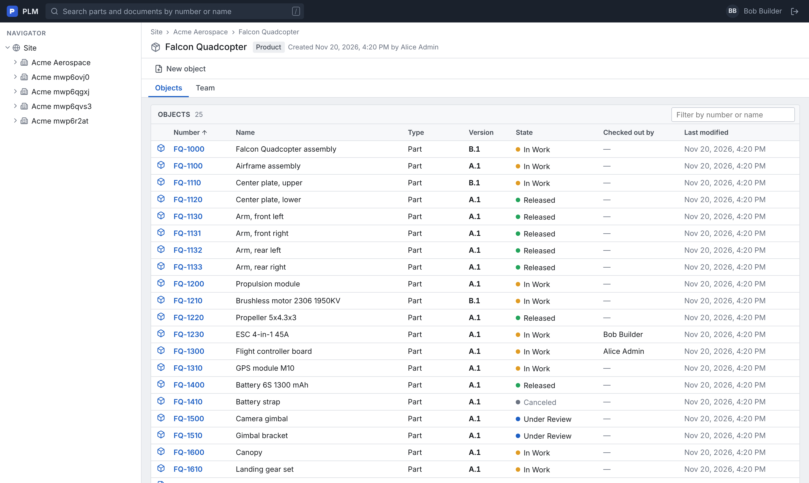

# Local development

## Prerequisites

| Tool | Version | Check |
|---|---|---|
| JDK | 21 (Temurin recommended) | `java -version` |
| Docker | Docker Desktop, OrbStack or Docker Engine with Compose v2 | `docker compose version` |
| Node.js | 22 LTS (for the web UI) | `node --version` |
| jq | any (for the curl walkthrough) | `jq --version` |
| make | optional, every target is a one-line command | `make --version` |

You do **not** need to install Gradle: use `./gradlew` (`gradlew.bat` on Windows).
If you don't have JDK 21, Gradle downloads one automatically (Foojay toolchain resolver).

## 1. Build and run all tests

```bash
./gradlew build
```

This compiles everything (compiler warnings fail the build), runs ktlint and runs all tests:

- **ArchitectureTest**: enforces module boundaries (ADR 0001). It includes a self-test proving
  the rule catches a deliberate violation.
- **Module integration tests** (`*IT`): run each module against a throwaway Postgres 18 (and, for
  the event relay, Redpanda) started by Testcontainers, with every migration applied. Docker must be
  running. No other setup is needed.
- **App tests** (`SecurityIT`, `VersioningApiIT`): drive the API over real HTTP with signed bearer
  tokens, the way the UI will. They mint their own tokens, so no Keycloak is needed.

The first run downloads dependencies and takes a few minutes. Later runs are fast.
Test reports: `backend/<project>/build/reports/tests/test/index.html`.

## 2. Start the dev stack

```bash
make up          # postgres, s3, keycloak, redpanda
make up-full     # + opensearch, temporal (≈3 GB RAM more)
```

Without make: `docker compose -f deploy/docker-compose.yml up -d` (add `--profile full` for everything).

| Service | URL / port | Credentials |
|---|---|---|
| PostgreSQL 18 | `localhost:5432`, db `plm` | `plm` / `plm` |
| S3 (SeaweedFS) | http://localhost:8333 | access key `plm`, secret `plm-dev-secret` |
| Keycloak | http://localhost:8180 (admin console) | `admin` / `admin` |
| Keycloak realm `plm` | users below | password = username |
| Redpanda (Kafka API) | `localhost:19092` | none |
| OpenSearch | http://localhost:9200 | none (security disabled in dev) |
| Temporal | gRPC `localhost:7233`, UI http://localhost:8233 | none |

Dev users in the `plm` realm (their IDs are fixed, so docs and tests can refer to them):

| User | Role | ID (`sub`) |
|---|---|---|
| `alice` | **site admin** (`plm-admin`) | `a11ce000-0000-4000-8000-000000000001` |
| `bob` | user | `b0b00000-0000-4000-8000-000000000002` |
| `carol` | user | `ca201000-0000-4000-8000-000000000003` |

These credentials are for local development only. The Keycloak container keeps no state:
restarting it re-imports the realm.

## 3. Run the backend

```bash
make run         # or: ./gradlew :backend:app:bootRun
```

Then check it. Health needs no login:

```bash
curl localhost:8080/actuator/health
```

Expected output: `{"groups":["liveness","readiness"],"status":"UP"}`

Override settings with environment variables: `PLM_DB_URL`, `PLM_DB_USER`, `PLM_DB_PASSWORD`,
`PLM_PORT`, `PLM_OIDC_ISSUER`, `PLM_OIDC_AUDIENCE`, `PLM_KAFKA_BOOTSTRAP`, `PLM_EVENTS_RELAY_ENABLED`.

## 4. Run the web UI

```bash
make ui-install    # once: cd frontend && npm ci
make ui            # cd frontend && npm run dev
```

Open http://localhost:5173 and sign in as `alice`, `bob` or `carol` (password = username).
The dev server proxies `/api` to the backend on :8080, so `make up` and `make run` must be running.

Try this:

1. As **alice**: on the Site page, click **New organization**. Inside it, create a **Product**.
   Open its **Team** tab and add `bob` as MEMBER. (bob must have signed in once first.)
2. As **bob** (use a private window): open the product, click **New object**, then **Check out**,
   edit attributes, **Check in** with a comment, and **Revise**. See the **History** tab.
3. As **alice**, open the same object: it shows "Checked out by Bob Builder" while bob has it.
   The **Audit** tab lists every change.
4. As **carol**: there's nothing to see, and the object's URL says *Not found*.



### API explorer

Swagger UI is at http://localhost:8080/swagger-ui.html. Click **Authorize**, choose the
`plm-web` client, sign in, and every request is sent with your token.

### Frontend checks

```bash
make ui-test       # lint, typecheck, unit tests (Vitest)
```

The browser end-to-end test drives the real UI, backend and Keycloak, so the whole stack must be
running (`make up`, `make run`, `make ui`):

```bash
make e2e           # Playwright; first time: cd frontend && npx playwright install chromium
```

### Changing the API

The API contract is committed at [`api/openapi.json`](../api/openapi.json). The frontend generates
its typed client from it (`npm run gen:api`, run automatically before dev, build and test).
After changing a controller or DTO:

```bash
make api-contract  # regenerate api/openapi.json
```

`OpenApiContractIT` fails the backend build if you forget. The frontend typecheck then shows every
place your change affects. Review the `api/openapi.json` diff in the PR as the API change.

## 5. Walkthrough with curl: login, teams, versioning, audit

Everything under `/api` needs a Keycloak access token. `scripts/token.sh <user>` prints one (it
uses the dev-only password grant). Tokens last an hour in dev.

With the stack and backend running, paste these into a terminal one block at a time.

**Sign in** as all three users, and see who you are:

```bash
API=localhost:8080/api/v1
ALICE=$(scripts/token.sh alice); BOB=$(scripts/token.sh bob); CAROL=$(scripts/token.sh carol)
curl -s $API/me -H "Authorization: Bearer $ALICE" | jq
curl -s -o /dev/null -w "without a token: %{http_code}\n" $API/me
```

**Alice (site admin) sets up** an organization and a product, and puts bob on the product team:

```bash
SITE=$(curl -s $API/contexts/site -H "Authorization: Bearer $ALICE" | jq -r .id)
ORG=$(curl -s -X POST $API/contexts -H "Authorization: Bearer $ALICE" -H 'Content-Type: application/json' \
  -d "{\"parentId\":\"$SITE\",\"kind\":\"ORGANIZATION\",\"name\":\"Acme\"}" | jq -r .id)
PRODUCT=$(curl -s -X POST $API/contexts -H "Authorization: Bearer $ALICE" -H 'Content-Type: application/json' \
  -d "{\"parentId\":\"$ORG\",\"kind\":\"PRODUCT\",\"name\":\"Drone X1\"}" | jq -r .id)
curl -s -X PUT $API/contexts/$PRODUCT/members/b0b00000-0000-4000-8000-000000000002 \
  -H "Authorization: Bearer $ALICE" -H 'Content-Type: application/json' -d '{"role":"MEMBER"}' | jq
```

**Bob creates a part** (`A.1`) and checks it out (working copy `A.2`). First he checks what he may do:

```bash
curl -s $API/contexts/$PRODUCT/permissions -H "Authorization: Bearer $BOB"; echo
PART=$(curl -s -X POST $API/objects -H "Authorization: Bearer $BOB" -H 'Content-Type: application/json' \
  -d "{\"typeId\":\"00000000-0000-7000-8000-000000000102\",\"contextId\":\"$PRODUCT\",\"name\":\"Motor mount\",\"attributes\":{\"material\":\"AL6061\"}}" \
  | jq -r .id); echo $PART
curl -s -X POST $API/objects/$PART/checkout -H "Authorization: Bearer $BOB" | jq '{version, status}'
```

**Alice tries to check it out too.** She gets `409 ALREADY_CHECKED_OUT ... by Bob Builder`:

```bash
curl -s -X POST $API/objects/$PART/checkout -H "Authorization: Bearer $ALICE" | jq '{status, code, detail}'
```

**Carol isn't on the team**, so the product and part don't exist for her (`404`). Then alice adds
her as a VIEWER: now she can read (`200`) but not check out (`403 ACCESS_DENIED`):

```bash
curl -s $API/objects/$PART -H "Authorization: Bearer $CAROL" | jq '{status, code}'
curl -s -X PUT $API/contexts/$PRODUCT/members/ca201000-0000-4000-8000-000000000003 \
  -H "Authorization: Bearer $ALICE" -H 'Content-Type: application/json' -d '{"role":"VIEWER"}' > /dev/null
curl -s -o /dev/null -w "carol reads: %{http_code}\n" $API/objects/$PART -H "Authorization: Bearer $CAROL"
curl -s -X POST $API/objects/$PART/checkout -H "Authorization: Bearer $CAROL" | jq '{status, code}'
```

**Bob edits, checks in, revises**, and lists the product (`B.1`, `A.2`, `A.1`):

```bash
curl -s -X PATCH $API/objects/$PART/working-copy -H "Authorization: Bearer $BOB" -H 'Content-Type: application/json' \
  -d '{"attributes":{"material":"Ti-6Al-4V"}}' | jq '{version, attributes}'
curl -s -X POST $API/objects/$PART/checkin -H "Authorization: Bearer $BOB" -H 'Content-Type: application/json' \
  -d '{"comment":"Switch to titanium"}' | jq '{version, checkedOutBy}'
curl -s -X POST $API/objects/$PART/revise -H "Authorization: Bearer $BOB" | jq .version
curl -s $API/objects/$PART/iterations -H "Authorization: Bearer $BOB" | jq '.[] | {version, comment, material: .attributes.material}'
curl -s "$API/objects?contextId=$PRODUCT" -H "Authorization: Bearer $BOB" | jq '.[] | {number, name, version}'
```

**Alice reads the audit trail.** Every change is there, with who did it and before/after values.
Only site admins can read it (bob gets `403`):

```bash
curl -s "$API/audit?aggregateId=$PART" -H "Authorization: Bearer $ALICE" | jq '.[] | {action, actor, occurredAt}'
curl -s -o /dev/null -w "bob reads audit: %{http_code}\n" "$API/audit" -H "Authorization: Bearer $BOB"
```

**See the same events on the event bus** (Ctrl-C to stop):

```bash
make events
```

### Types and attributes

Every type has typed attributes, inherited by its subtypes. Part and Document come with
out-of-the-box attributes (Part: description, source, default unit, assembly mode, end item,
phantom, gathering part, trace code, material, mass. Document: title, description, category,
department). Values are validated by the server on every write, and defaults are applied:

```bash
curl -s $API/types/00000000-0000-7000-8000-000000000102/attributes -H "Authorization: Bearer $BOB" \
  | jq '.[] | {name, dataType, defaultValue}'
```

Site admins extend the model without code. For example, a *Fastener* part subtype with a
required, pattern-checked thread size:

```bash
FASTENER=$(curl -s -X POST $API/types -H "Authorization: Bearer $ALICE" -H 'Content-Type: application/json' \
  -d '{"parentId":"00000000-0000-7000-8000-000000000102","name":"Fastener","displayName":"Fastener"}' | jq -r .id)
curl -s -X POST $API/types/$FASTENER/attributes -H "Authorization: Bearer $ALICE" -H 'Content-Type: application/json' \
  -d '{"name":"threadSize","dataType":"STRING","labels":{"en":"Thread size"},"required":true,"pattern":"M\\d+(x[\\d.]+)?"}' | jq '{name, required, pattern}'
```

The **New object** form in the UI now offers *Fastener*, with *Thread size* as a required field.

| Data type | Value format |
|---|---|
| STRING, TEXT, URL | `"text"` |
| INTEGER, REAL | `42`, `1.5` |
| QUANTITY | `{"value": 12.5, "unit": "mm"}`. Units: `GET /api/v1/units` |
| BOOLEAN | `true` |
| DATE / TIMESTAMP | `"2026-11-20"` / `"2026-11-20T10:15:30Z"` |
| ENUMERATION | a value key, e.g. `"buy"`. Lists: `GET /api/v1/enumerations` |

Attributes can be multi-valued (a JSON list), required, immutable after creation, and limited by
length, pattern or min/max (for quantities, in the dimension's base unit). Attributes and
enumeration values are never deleted, only deactivated: existing data stays valid.

### How access works

- **Contexts** form a tree: Site → Organization → Product / Library / Project.
- **Teams**: each context has members with a role, `VIEWER`, `MEMBER` or `MANAGER`. A role on a
  context also applies to everything below it.
- **Policies** say what each role may do. The defaults sit on the site and are inherited
  everywhere: VIEWER = READ · MEMBER = READ, CREATE, MODIFY, REVISE · MANAGER = all of those + MANAGE.
  Policies can also be scoped to one type or one lifecycle state (no API for custom policies yet).
- **Site admins** (Keycloak role `plm-admin`) can do everything, and are the only ones who create
  organizations, define types and read the audit log.
- If you can't READ something, it doesn't exist for you (`404`). If you can read it but lack the
  permission for an action, you get `403 ACCESS_DENIED`.
- Lists are filtered **inside the SQL query**, so they stay fast and never leak counts.

### Endpoints

| Method | Path | Does |
|---|---|---|
| GET | `/api/v1/me` | The signed-in user, and whether they are a site admin |
| GET | `/api/v1/principals?username=bob` · `/principals/{id}` | Look up a user (after their first sign-in) |
| GET | `/api/v1/contexts/site` | Root context |
| GET | `/api/v1/contexts/{id}` · `/{id}/children` | Read contexts (only those on your team's path) |
| POST | `/api/v1/contexts` | Create `{parentId, kind, name}`. ORGANIZATION: site admin only. Others: MANAGE on the parent. You become MANAGER |
| GET | `/api/v1/contexts/{id}/members` | Team of this context |
| PUT / DELETE | `/api/v1/contexts/{id}/members/{principalId}` | Add, change `{role}` or remove a member (needs MANAGE) |
| GET | `/api/v1/contexts/{id}/permissions[?typeId=]` | What you may do here |
| GET / POST | `/api/v1/types` | List types / create subtype `{parentId, name, displayName}` (site admin) |
| GET | `/api/v1/objects?contextId=&limit=&after=` | Objects you can read in a context, paged |
| POST | `/api/v1/objects` | Create `{typeId, contextId, name, number?, attributes?}` → A.1 |
| GET | `/api/v1/objects/{id}` | Latest checked-in iteration, and who has it checked out |
| GET | `/api/v1/objects/{id}/iterations` | History, newest first |
| POST | `/api/v1/objects/{id}/checkout` | Create your working copy |
| GET / PATCH | `/api/v1/objects/{id}/working-copy` | Read / replace your working copy's `attributes` |
| POST | `/api/v1/objects/{id}/checkin` | Optional `{comment}` |
| POST | `/api/v1/objects/{id}/undo-checkout` | Discard your working copy |
| POST | `/api/v1/objects/{id}/revise` | Next revision (A.3 → B.1) |
| GET | `/api/v1/audit[?aggregateId=&limit=&before=]` | Audit trail, newest first (site admin) |
| GET / POST | `/api/v1/types/{typeId}/attributes` | Effective attributes (incl. inherited) / define one (site admin) |
| PUT | `/api/v1/types/{typeId}/attributes/{id}` | Change an attribute's settings: labels, constraints, default, active (site admin) |
| GET / POST / PUT | `/api/v1/enumerations[/{id}]` | Value lists. Values can be added or deactivated, never removed |
| GET | `/api/v1/units` | Units of measure by dimension |

Errors are [RFC 9457](https://www.rfc-editor.org/rfc/rfc9457) problem details with a stable `code`,
e.g. `{"status":409,"code":"ALREADY_CHECKED_OUT","details":{"checkedOutBy":"<user id>"}}`.

Prefer an editor? [`docs/api/plm.http`](api/plm.http) runs the same flow in VS Code's
*REST Client* extension.

## 6. Look under the hood

Open a SQL shell:

```bash
docker compose -f deploy/docker-compose.yml exec postgres psql -U plm -d plm
```

Useful queries:

```sql
select revision || '.' || iteration as version, status, attrs, comment from object_iteration order by seq;
select event_type, published_at is not null as relayed from outbox_event order by seq;
select action, actor, occurred_at from audit_log order by seq desc limit 20;
select c.name, m.principal_id, m.role from context_member m join context c on c.id = m.context_id;
```

## 7. Everyday commands

| Command | What it does |
|---|---|
| `make fmt` / `./gradlew ktlintFormat` | Auto-fix code style |
| `make ui` / `make ui-test` / `make e2e` | Web UI dev server / its checks / browser end-to-end test |
| `make api-contract` | Regenerate `api/openapi.json` after an API change |
| `./gradlew :backend:app:test --tests '*SecurityIT'` | Run one test class |
| `scripts/token.sh bob` | Print an access token for a dev user |
| `make events` | Tail the domain-event topic |
| `make down` | Stop services, keep data |
| `make reset` | Stop services and **delete** all local data |

## Troubleshooting

- **`Could not find a valid Docker environment`**: Docker isn't running. Start Docker Desktop.
- **Docker Hub `429 Too Many Requests`**: pull through a mirror:
  `IMAGE_PREFIX=mirror.gcr.io/ make up`. For Testcontainers, put
  `hub.image.name.prefix=mirror.gcr.io/` in `~/.testcontainers.properties`.
- **`401` on every API call**: the token expired (1 hour), or Keycloak restarted and has new
  signing keys. Run `scripts/token.sh` again. If the backend started before Keycloak was up,
  restart the backend too.
- **`404` for something that exists**: you're not on its team. Ask a manager or a site admin
  to add you.
- **Relay warnings in the backend log** (`Outbox relay failed`): Redpanda isn't running. Run
  `make up`. Events wait safely in the outbox and are sent once it's back.
- **Database in a weird state** after switching branches: `make reset && make up` gives you a
  fresh, empty database.
- **Port already in use**: another local Postgres or Keycloak is running. Stop it, or change the
  left side of the port mapping in `deploy/docker-compose.yml`.
- **UI shows "Sign-in failed"** or loops back to Keycloak: Keycloak was restarted (it keeps no
  state), so your session is gone. Sign in again. If it persists, clear the site data for
  localhost:5173.
- **UI loads but every panel errors**: the backend isn't running on :8080 (`make run`).
- **Apple Silicon**: all images are multi-arch. No extra flags needed.
