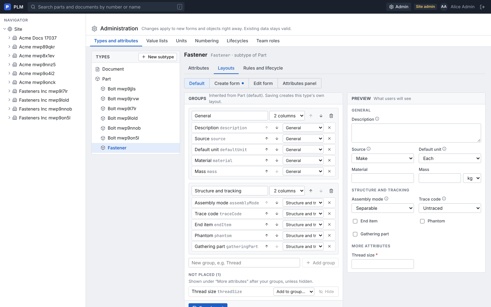
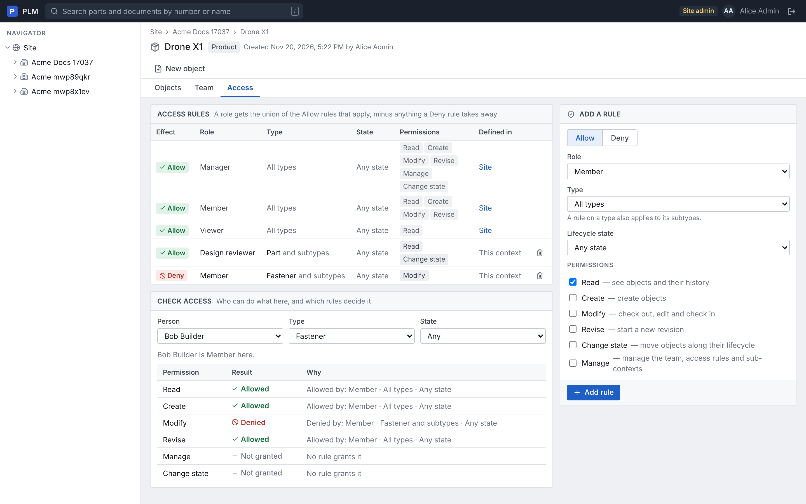
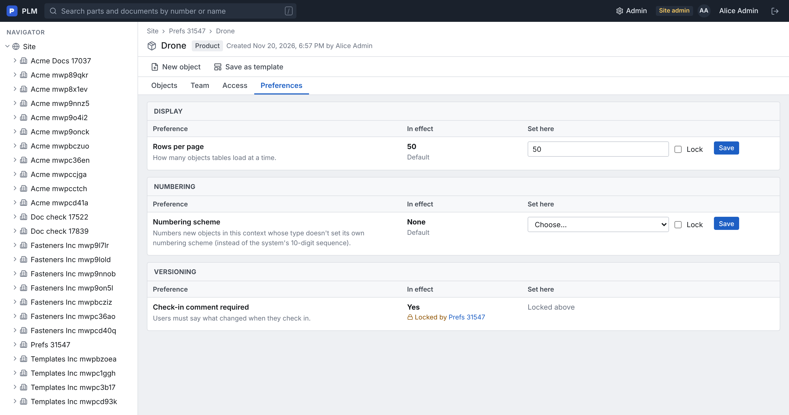
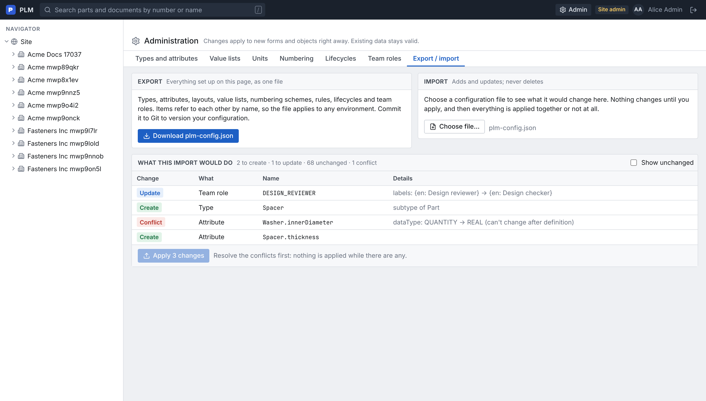

# Local development

## Prerequisites

| Tool | Version | Check |
|---|---|---|
| JDK | 21 (Temurin recommended) | `java -version` |
| Docker | Docker Desktop, OrbStack or Docker Engine with Compose v2 | `docker compose version` |
| Node.js | 22 LTS (for the web UI) | `node --version` |
| jq | any (for the curl walkthrough) | `jq --version` |
| make | optional, every target is a one-line command | `make --version` |

You do **not** need to install Gradle: use `./gradlew` (`gradlew.bat` on Windows).
If you don't have JDK 21, Gradle downloads one automatically (Foojay toolchain resolver).

## 1. Build and run all tests

```bash
./gradlew build
```

This compiles everything (compiler warnings fail the build), runs ktlint and runs all tests:

- **ArchitectureTest**: enforces module boundaries (ADR 0001). It includes a self-test proving
  the rule catches a deliberate violation.
- **Module integration tests** (`*IT`): run each module against a throwaway Postgres 18 (and, for
  the event relay, Redpanda) started by Testcontainers, with every migration applied. Docker must be
  running. No other setup is needed.
- **App tests** (`SecurityIT`, `VersioningApiIT`): drive the API over real HTTP with signed bearer
  tokens, the way the UI will. They mint their own tokens, so no Keycloak is needed.

The first run downloads dependencies and takes a few minutes. Later runs are fast.
Test reports: `backend/<project>/build/reports/tests/test/index.html`.

## 2. Start the dev stack

```bash
make up          # postgres, s3, keycloak, redpanda
make up-full     # + opensearch, temporal (≈3 GB RAM more)
```

Without make: `docker compose -f deploy/docker-compose.yml up -d` (add `--profile full` for everything).

| Service | URL / port | Credentials |
|---|---|---|
| PostgreSQL 18 | `localhost:5432`, db `plm` | `plm` / `plm` |
| S3 (SeaweedFS) | http://localhost:8333 | access key `plm`, secret `plm-dev-secret` |
| Keycloak | http://localhost:8180 (admin console) | `admin` / `admin` |
| Keycloak realm `plm` | users below | password = username |
| Redpanda (Kafka API) | `localhost:19092` | none |
| OpenSearch | http://localhost:9200 | none (security disabled in dev) |
| Temporal | gRPC `localhost:7233`, UI http://localhost:8233 | none |

Dev users in the `plm` realm (their IDs are fixed, so docs and tests can refer to them):

| User | Role | ID (`sub`) |
|---|---|---|
| `alice` | **site admin** (`plm-admin`) | `a11ce000-0000-4000-8000-000000000001` |
| `bob` | user | `b0b00000-0000-4000-8000-000000000002` |
| `carol` | user | `ca201000-0000-4000-8000-000000000003` |

These credentials are for local development only. The Keycloak container keeps no state:
restarting it re-imports the realm.

## 3. Run the backend

```bash
make run         # or: ./gradlew :backend:app:bootRun
```

Then check it. Health needs no login:

```bash
curl localhost:8080/actuator/health
```

Expected output: `{"groups":["liveness","readiness"],"status":"UP"}`

Override settings with environment variables: `PLM_DB_URL`, `PLM_DB_USER`, `PLM_DB_PASSWORD`,
`PLM_PORT`, `PLM_OIDC_ISSUER`, `PLM_OIDC_AUDIENCE`, `PLM_KAFKA_BOOTSTRAP`, `PLM_EVENTS_RELAY_ENABLED`.

## 4. Run the web UI

```bash
make ui-install    # once: cd frontend && npm ci
make ui            # cd frontend && npm run dev
```

Open http://localhost:5173 and sign in as `alice`, `bob` or `carol` (password = username).
The dev server proxies `/api` to the backend on :8080, so `make up` and `make run` must be running.

What you see depends on your role. **Site administrators** see the Site and every organization;
**organization administrators** (managers of an organization) see the organizations they manage;
everyone else sees only the products, libraries and projects they're on the team of (directly or
through their organization), and lands on them after signing in. This shapes navigation only:
what anyone may read or change is still decided by access rules.

The sidebar browses by kind of container: **Site**, **Organizations**, **Products**, **Libraries**
and **Projects**. Each kind opens a list of every one you can see (`/browse/products`, with a filter
by organization and its own **New product** action), and the kind you're in lists its containers
right in the sidebar. Pin the ones you use; recent visits are kept too. Products, libraries and projects show
their organization's name beside them; turn that off under **My preferences → Display → Show
organization names** (or for everyone, as a site default on the Site's **Preferences** tab).

Each kind of container has its own tabs and actions:

| Container | Tabs | Actions |
|---|---|---|
| Site | Organizations, Overview, Team, Access, Preferences | New organization (site admins) |
| Organization | Overview, Products, Libraries, Projects, Team, Access, Preferences, Shared teams, Templates | New product / library / project (on their tabs), Save as template |
| Product, library, project | Contents, Overview, Team, Access, Preferences | New part, New document (one per base class with creatable types), Save as template |

Try this:

1. As **alice**: on the Site page, click **New organization**. In it, open **Products** and click
   **New product**. Open its **Team** tab and add `bob` as MEMBER. (bob must have signed in once first.)
2. As **bob** (use a private window): open the product, click **New part**, then **Check out**,
   edit attributes, **Check in** with a comment, and **Revise**. See the **History** tab.
3. As **alice**, open the same object: it shows "Checked out by Bob Builder" while bob has it.
   The **Audit** tab lists every change.
4. As **carol**: there's nothing to see, and the object's URL says *Not found*.


**Administration** (site admins: the **Admin** link in the top bar) is where the data model is
configured without code:

- **Types and attributes**: create subtypes; add and edit attributes (data type, value list or
  unit, required, fixed after creation, length, pattern, range, default value); per screen, arrange
  attributes in groups with a live preview of the form; set numbering, revision scheme, manual
  numbers and the lifecycle.
- **Value lists**, **Units**, **Numbering** schemes and **Team roles**.
- **Lifecycles**: see each template as a state diagram; create a new one or copy an existing one,
  with states (editable, revisable, initial) and a matrix of allowed transitions.

Try it: under **Value lists** create *Thread standard* (metric, unified); under **Numbering** create
*Bolts* with prefix `BLT-`; under **Types and attributes** select *Part*, click **New subtype**
*Bolt*, add a required *Thread standard* attribute, choose the *Bolts* numbering under **Rules and
lifecycle**, and give its **Create form** a *Thread* group first. Then create a Bolt in a product:
the form follows the layout and the number is `BLT-000001`. (`e2e/admin-flow.spec.ts` does exactly this.)



**Search** from the top bar: press `/`, type part of a number or name, pick with the arrow keys and
Enter, or press Enter on "See all results" for the full list (every context you can read).

### API explorer

Swagger UI is at http://localhost:8080/swagger-ui.html. Click **Authorize**, choose the
`plm-web` client, sign in, and every request is sent with your token.

### Frontend checks

```bash
make ui-test       # lint, typecheck, unit tests (Vitest)
```

The browser end-to-end test drives the real UI, backend and Keycloak, so the whole stack must be
running (`make up`, `make run`, `make ui`):

```bash
make e2e           # Playwright; first time: cd frontend && npx playwright install chromium
```

### Changing the API

The API contract is committed at [`api/openapi.json`](../api/openapi.json). The frontend generates
its typed client from it (`npm run gen:api`, run automatically before dev, build and test).
After changing a controller or DTO:

```bash
make api-contract  # regenerate api/openapi.json
```

`OpenApiContractIT` fails the backend build if you forget. The frontend typecheck then shows every
place your change affects. Review the `api/openapi.json` diff in the PR as the API change.

## 5. Walkthrough with curl: login, teams, versioning, audit

Everything under `/api` needs a Keycloak access token. `scripts/token.sh <user>` prints one (it
uses the dev-only password grant). Tokens last an hour in dev.

With the stack and backend running, paste these into a terminal one block at a time.

**Sign in** as all three users, and see who you are:

```bash
API=localhost:8080/api/v1
ALICE=$(scripts/token.sh alice); BOB=$(scripts/token.sh bob); CAROL=$(scripts/token.sh carol)
curl -s $API/me -H "Authorization: Bearer $ALICE" | jq
curl -s -o /dev/null -w "without a token: %{http_code}\n" $API/me
```

**Alice (site admin) sets up** an organization and a product, and puts bob on the product team:

```bash
SITE=$(curl -s $API/contexts/site -H "Authorization: Bearer $ALICE" | jq -r .id)
ORG=$(curl -s -X POST $API/contexts -H "Authorization: Bearer $ALICE" -H 'Content-Type: application/json' \
  -d "{\"parentId\":\"$SITE\",\"kind\":\"ORGANIZATION\",\"name\":\"Acme\"}" | jq -r .id)
PRODUCT=$(curl -s -X POST $API/contexts -H "Authorization: Bearer $ALICE" -H 'Content-Type: application/json' \
  -d "{\"parentId\":\"$ORG\",\"kind\":\"PRODUCT\",\"name\":\"Drone X1\"}" | jq -r .id)
curl -s -X PUT $API/contexts/$PRODUCT/members/b0b00000-0000-4000-8000-000000000002 \
  -H "Authorization: Bearer $ALICE" -H 'Content-Type: application/json' -d '{"role":"MEMBER"}' | jq
```

**Bob creates a part** (`A.1`) and checks it out (working copy `A.2`). First he checks what he may do:

```bash
curl -s $API/contexts/$PRODUCT/permissions -H "Authorization: Bearer $BOB"; echo
PART=$(curl -s -X POST $API/objects -H "Authorization: Bearer $BOB" -H 'Content-Type: application/json' \
  -d "{\"typeId\":\"00000000-0000-7000-8000-000000000102\",\"contextId\":\"$PRODUCT\",\"name\":\"Motor mount\",\"attributes\":{\"material\":\"AL6061\"}}" \
  | jq -r .id); echo $PART
curl -s -X POST $API/objects/$PART/checkout -H "Authorization: Bearer $BOB" | jq '{version, status}'
```

**Alice tries to check it out too.** She gets `409 ALREADY_CHECKED_OUT ... by Bob Builder`:

```bash
curl -s -X POST $API/objects/$PART/checkout -H "Authorization: Bearer $ALICE" | jq '{status, code, detail}'
```

**Carol isn't on the team**, so the product and part don't exist for her (`404`). Then alice adds
her as a VIEWER: now she can read (`200`) but not check out (`403 ACCESS_DENIED`):

```bash
curl -s $API/objects/$PART -H "Authorization: Bearer $CAROL" | jq '{status, code}'
curl -s -X PUT $API/contexts/$PRODUCT/members/ca201000-0000-4000-8000-000000000003 \
  -H "Authorization: Bearer $ALICE" -H 'Content-Type: application/json' -d '{"role":"VIEWER"}' > /dev/null
curl -s -o /dev/null -w "carol reads: %{http_code}\n" $API/objects/$PART -H "Authorization: Bearer $CAROL"
curl -s -X POST $API/objects/$PART/checkout -H "Authorization: Bearer $CAROL" | jq '{status, code}'
```

**Bob edits and checks in.** Revising is refused: the part is still *In Work*, and only
*Released* parts can be revised:

```bash
curl -s -X PATCH $API/objects/$PART/working-copy -H "Authorization: Bearer $BOB" -H 'Content-Type: application/json' \
  -d '{"attributes":{"material":"Ti-6Al-4V"}}' | jq '{version, attributes}'
curl -s -X POST $API/objects/$PART/checkin -H "Authorization: Bearer $BOB" -H 'Content-Type: application/json' \
  -d '{"comment":"Switch to titanium"}' | jq '{version, checkedOutBy}'
curl -s -X POST $API/objects/$PART/revise -H "Authorization: Bearer $BOB" | jq '{status, code, detail}'
```

**Alice releases it** (In Work → Under Review → Released). Changing state needs the PROMOTE
permission, which managers and site admins have. Bob, a member, doesn't:

```bash
curl -s $API/objects/$PART/lifecycle -H "Authorization: Bearer $ALICE" | jq '{state, editable, revisable, nextStates}'
for S in UNDER_REVIEW RELEASED; do
  curl -s -X POST $API/objects/$PART/state -H "Authorization: Bearer $ALICE" -H 'Content-Type: application/json' \
    -d "{\"state\":\"$S\",\"comment\":\"Design review DR-12\"}" | jq -r .latest.state
done
```

**Now Bob revises**, and lists the product (`B.1` In Work, `A.2` Released, `A.1`):

```bash
curl -s -X POST $API/objects/$PART/revise -H "Authorization: Bearer $BOB" | jq '{version, state: .latest.state}'
curl -s $API/objects/$PART/iterations -H "Authorization: Bearer $BOB" | jq '.[] | {version, state, comment, material: .attributes.material}'
curl -s "$API/objects?contextId=$PRODUCT" -H "Authorization: Bearer $BOB" | jq '.[] | {number, name, version}'
```

**Alice reads the audit trail.** Every change is there, with who did it and before/after values.
Only site admins can read it (bob gets `403`):

```bash
curl -s "$API/audit?aggregateId=$PART" -H "Authorization: Bearer $ALICE" | jq '.[] | {action, actor, occurredAt}'
curl -s -o /dev/null -w "bob reads audit: %{http_code}\n" "$API/audit" -H "Authorization: Bearer $BOB"
```

**See the same events on the event bus** (Ctrl-C to stop):

```bash
make events
```

### Types and attributes

Every type has typed attributes, inherited by its subtypes. Part and Document come with
out-of-the-box attributes (Part: description, source, default unit, assembly mode, end item,
phantom, gathering part, trace code, material, mass. Document: title, description, category,
department). Values are validated by the server on every write, and defaults are applied:

```bash
curl -s $API/types/00000000-0000-7000-8000-000000000102/attributes -H "Authorization: Bearer $BOB" \
  | jq '.[] | {name, dataType, defaultValue}'
```

Site admins extend the model without code. For example, a *Fastener* part subtype with a
required, pattern-checked thread size:

```bash
FASTENER=$(curl -s -X POST $API/types -H "Authorization: Bearer $ALICE" -H 'Content-Type: application/json' \
  -d '{"parentId":"00000000-0000-7000-8000-000000000102","name":"Fastener","displayName":"Fastener"}' | jq -r .id)
curl -s -X POST $API/types/$FASTENER/attributes -H "Authorization: Bearer $ALICE" -H 'Content-Type: application/json' \
  -d '{"name":"threadSize","dataType":"STRING","labels":{"en":"Thread size"},"required":true,"pattern":"M\\d+(x[\\d.]+)?"}' | jq '{name, required, pattern}'
```

The **New part** form in the UI now offers *Fastener*, with *Thread size* as a required field.

| Data type | Value format |
|---|---|
| STRING, TEXT, URL | `"text"` |
| INTEGER, REAL | `42`, `1.5` |
| QUANTITY | `{"value": 12.5, "unit": "mm"}`. Units: `GET /api/v1/units` |
| BOOLEAN | `true` |
| DATE / TIMESTAMP | `"2026-11-20"` / `"2026-11-20T10:15:30Z"` |
| ENUMERATION | a value key, e.g. `"buy"`. Lists: `GET /api/v1/enumerations` |

Attributes can be multi-valued (a JSON list), required, immutable after creation, and limited by
length, pattern or min/max (for quantities, in the dimension's base unit). Attributes and
enumeration values are never deleted, only deactivated: existing data stays valid.

### Layouts

A **layout** decides which attributes a screen shows, in which groups and order, in one or two
columns. Screens are `CREATE` (new object form), `EDIT` (working copy form) and `INFO` (attributes
panel), plus `DEFAULT` for any screen without its own. Part and Document come with a default
layout. Subtypes inherit their parent's layouts. Attributes a layout doesn't place (like the
Fastener's *Thread size*) show up in a trailing *More attributes* group, so nothing disappears.

See what the create form of a Fastener will look like, and where the layout comes from:

```bash
curl -s $API/types/$FASTENER/layouts/CREATE -H "Authorization: Bearer $BOB" \
  | jq '{source, groups: [.groups[] | {key, attributes}]}'
```

Give the Fastener create form its own layout: thread first, and no *Gathering part* checkbox
(hidden attributes keep their default value):

```bash
curl -s -X PUT $API/types/$FASTENER/layouts/CREATE -H "Authorization: Bearer $ALICE" -H 'Content-Type: application/json' \
  -d '{"groups":[{"key":"fastener","labels":{"en":"Fastener"},"columns":2,"attributes":["threadSize","material","mass"]},
                 {"key":"general","labels":{"en":"General"},"columns":2,"attributes":["description","source","defaultUnit"]}],
       "hidden":["gatheringPart"]}' | jq '{screen, groups: [.groups[].key], hidden}'
```

The other screens still use the Part layout. `DELETE $API/types/$FASTENER/layouts/CREATE` goes
back to inheriting it. Invalid layouts are refused with every problem listed (`INVALID_LAYOUT`),
for example an unknown attribute, or hiding a required attribute that has no default.

### Lifecycles, numbering and revisions

Parts and documents follow the out-of-the-box **Basic** lifecycle:

```
In Work ──► Under Review ──► Released ──► Obsolete
   │  ◄──────────┘
   └──► Canceled
```

- Only **In Work** objects can be checked out. **Released** objects are read-only.
- Only **Released** objects can be **revised**. The new revision starts In Work again; the released
  iteration keeps its state in history.
- Changing state needs the **PROMOTE** permission (team managers by default). A site admin can
  **override** to any state, which is recorded in the audit trail.
- Admins can define their own lifecycles (states, which are editable or revisable, allowed
  transitions) and assign them per type; subtypes inherit.
- Per type, admins can also set a **numbering scheme** (e.g. `PRT-` + 6 digits) and a **revision
  scheme** (ASME letters, A–Z, 1, 2, 3…, or 0, 1, 2…).

Each object keeps the lifecycle and revision scheme it was created with, so changing a type's
rules never changes existing objects.

### How access works

- **Contexts** form a tree: Site → Organization → Product / Library / Project.
- **Teams**: each context has members with a role. `VIEWER`, `MEMBER` and `MANAGER` ship out of
  the box; site admins add their own (e.g. `DESIGN_REVIEWER`). A role on a context also applies to
  everything below it.
- **Policies** (access rules) say what each role may do. The defaults sit on the site and are
  inherited everywhere: VIEWER = READ · MEMBER = READ, CREATE, MODIFY, REVISE · MANAGER = all of
  those + MANAGE, PROMOTE. A rule can be limited to a type (and then also covers its subtypes) and
  to a lifecycle state. **Allow** rules add up; a **Deny** rule takes a permission away whatever
  any Allow says.
- Context managers change the rules of their contexts; rules on the site are for site admins.
- **Site admins** (Keycloak role `plm-admin`) can do everything, and are the only ones who create
  organizations, define types and read the audit log.
- If you can't READ something, it doesn't exist for you (`404`). If you can read it but lack the
  permission for an action, you get `403 ACCESS_DENIED`.
- Lists are filtered **inside the SQL query**, so they stay fast and never leak counts.

### Team roles and access rules

Alice (site admin) defines a **custom role** and makes carol a design reviewer of the product.
A new role can do nothing until a rule says so, so the part disappears for carol (`404`):

```bash
curl -s -X POST $API/team-roles -H "Authorization: Bearer $ALICE" -H 'Content-Type: application/json' \
  -d '{"key":"DESIGN_REVIEWER","labels":{"en":"Design reviewer"},"description":"Reviews and releases designs."}' | jq -c
curl -s -X PUT $API/contexts/$PRODUCT/members/ca201000-0000-4000-8000-000000000003 \
  -H "Authorization: Bearer $ALICE" -H 'Content-Type: application/json' -d '{"role":"DESIGN_REVIEWER"}' > /dev/null
curl -s -o /dev/null -w "carol reads: %{http_code}\n" $API/objects/$PART -H "Authorization: Bearer $CAROL"
```

As manager of the product, alice **adds a rule**: design reviewers may read parts and change their
state. Carol can read the part again:

```bash
curl -s -X POST $API/contexts/$PRODUCT/policies -H "Authorization: Bearer $ALICE" -H 'Content-Type: application/json' \
  -d '{"role":"DESIGN_REVIEWER","typeId":"00000000-0000-7000-8000-000000000102","permissions":["READ","PROMOTE"]}' \
  | jq -c '{role, effect, permissions}'
curl -s -o /dev/null -w "carol reads: %{http_code}\n" $API/objects/$PART -H "Authorization: Bearer $CAROL"
```

A **deny rule**: members may no longer edit *Fasteners* in this product (other parts are not
affected). Bob's permissions for each type show the difference:

```bash
curl -s -X POST $API/contexts/$PRODUCT/policies -H "Authorization: Bearer $ALICE" -H 'Content-Type: application/json' \
  -d "{\"role\":\"MEMBER\",\"typeId\":\"$FASTENER\",\"effect\":\"DENY\",\"permissions\":[\"MODIFY\"]}" | jq -c '{role, effect, permissions}'
curl -s "$API/contexts/$PRODUCT/permissions?typeId=00000000-0000-7000-8000-000000000102" -H "Authorization: Bearer $BOB"; echo
curl -s "$API/contexts/$PRODUCT/permissions?typeId=$FASTENER" -H "Authorization: Bearer $BOB"; echo
```

**Why** can't bob edit fasteners? Ask the system, instead of reading the rules yourself. Managers
can ask about anyone, everyone can ask about themselves:

```bash
curl -s "$API/contexts/$PRODUCT/access/explain?principalId=b0b00000-0000-4000-8000-000000000002&typeId=$FASTENER" \
  -H "Authorization: Bearer $ALICE" \
  | jq -c '.permissions[] | {permission, granted, deniedBy: [.deniedBy[] | .role], allowedBy: [.allowedBy[] | .role]}'
```

In the UI, the product's **Access** tab (managers only) lists the rules in effect, inherited ones
included, lets you add and delete rules, and has a **Check access** panel with the same explanation.



### Shared teams and context templates

A **shared team** is a group of people with roles, kept in one place (**Admin → Shared teams**)
and attached to any number of contexts from their **Team** tab. Its members get their role in
every context it's attached to; change the team once and it applies everywhere.

A **context template** is what a new organization, product, library or project starts with:
access rules, team members and shared teams. Set a context up the way you like, click **Save as
template** (site admins), then pick the template in the **New product** (library, project, organization) dialog. Templates are
listed under **Admin → Context templates** and travel in configuration bundles.

```bash
TEAM=$(curl -s -X POST $API/shared-teams -H "Authorization: Bearer $ALICE" -H 'Content-Type: application/json' \
  -d '{"name":"Reviewers"}' | jq -r .id)
curl -s -X PUT $API/shared-teams/$TEAM/members/b0b00000-0000-4000-8000-000000000002 -H "Authorization: Bearer $ALICE" \
  -H 'Content-Type: application/json' -d '{"role":"VIEWER"}' | jq -c '{name, members: [.members[].role]}'
TEMPLATE=$(curl -s -X POST $API/context-templates -H "Authorization: Bearer $ALICE" -H 'Content-Type: application/json' \
  -d '{"name":"Regulated product","kind":"PRODUCT","content":{"sharedTeams":["Reviewers"],
       "policies":[{"role":"MEMBER","type":"Document","state":"RELEASED","effect":"DENY","permissions":["REVISE"]}]}}' | jq -r .id)
curl -s -X POST $API/contexts -H "Authorization: Bearer $ALICE" -H 'Content-Type: application/json' \
  -d "{\"parentId\":\"$ORG\",\"kind\":\"PRODUCT\",\"name\":\"Pump\",\"templateId\":\"$TEMPLATE\"}" | jq -c '{name, kind}'
```

**Organization administration.** Managers of an organization don't need to be site admins to run
it: on the organization's page they get **Shared teams** and **Templates** tabs for the
organization's own teams and templates, which are usable only inside it. **Save as template** on
one of their products makes an organization template; site admins can choose to make it site-wide.

### Lifecycle versions, entry criteria and revision series

Lifecycle templates are versioned: **Admin → Lifecycles → Edit** saves a new version. Types move to
it; objects keep the version they were created with until a site admin moves them (**More →
Change lifecycle** on the object, choosing a state if the old one no longer exists). Each state can
list attributes **required to enter** it, and a **revision series**: revisions started from that
state continue in it, e.g. prototype revisions 1, 2, 3, then A once approved.

```bash
LC=$(curl -s -X POST $API/lifecycles -H "Authorization: Bearer $ALICE" -H 'Content-Type: application/json' -d '{
  "name":"Prototype","labels":{"en":"Prototype"},"initialState":"DRAFT",
  "states":[{"key":"DRAFT","labels":{"en":"Draft"},"editable":true},
            {"key":"APPROVED","labels":{"en":"Approved"},"revisable":true,"requiredAttributes":["material"],"revisionScheme":"ALPHABETIC_ASME"}],
  "transitions":[{"from":"DRAFT","to":"APPROVED"}]}')
curl -s -X PUT $API/lifecycles/$(echo "$LC" | jq -r .id) -H "Authorization: Bearer $ALICE" -H 'Content-Type: application/json' \
  -d "$(echo "$LC" | jq '{name, labels, initialState, states, transitions} | .states[0].labels.en = "Drafting"')" | jq -c '{version, latest}'
```

Approving an object without a material is refused with `ENTRY_CRITERIA_NOT_MET`.

### Global attributes, dependent lists, units and type properties

- **Global attributes** (**Admin → Global attributes**) are defined once and used by any number of
  types, e.g. an *Export class* on both parts and documents. Changing one changes it everywhere.
- **Dependent value lists**: in a value-list attribute's dialog, *Allowed values depend on* another
  value list, with a grid of which values go with which. Forms only offer the allowed values, and
  the server refuses others (`NOT_ALLOWED_FOR_PARENT`).
- **Units**: **Admin → Units → Add a unit**, in an existing dimension or a new one.
- **Type properties** (**Admin → Types → Properties**): icon, translated names, description, and
  *Abstract*: a type that only groups subtypes and can't be created itself.

```bash
G=$(curl -s -X POST $API/attributes/global -H "Authorization: Bearer $ALICE" -H 'Content-Type: application/json' \
  -d '{"name":"exportClass","dataType":"STRING","labels":{"en":"Export class"}}' | jq -r .id)
curl -s -o /dev/null -w "%{http_code}\n" -X PUT $API/types/00000000-0000-7000-8000-000000000101/global-attributes/$G \
  -H "Authorization: Bearer $ALICE"
curl -s $API/types/00000000-0000-7000-8000-000000000101/attributes -H "Authorization: Bearer $BOB" \
  | jq -c '[.[] | select(.global) | .name]'
```

### Actions

Every action on an object (check out, check in, revise, set state, copy link, rename…) is an entry
in the **action registry**, declared as data: label, icon, placement (object toolbar or More menu),
order, group, the types and states it applies to, and the permission it needs. The object page
draws its toolbar and More menu from `GET /api/v1/objects/{id}/actions`, which lists what you see
on that object in display order, and says why each disabled action can't be used right now.

Site administrators adjust actions under **Admin → Actions**: move an action between the toolbar
and the More menu, reorder, hide it, rename it, or restrict it to some types (subtypes included)
and states. Only the changes are stored, so improvements to built-in actions still arrive; **Reset**
goes back to the defaults. Extensions will add their own actions to the same registry (roadmap 2.3, 2.4).

```bash
# Show Revise only on Released objects, and move Copy link to the toolbar
curl -s -X PUT $API/actions/object.revise/configuration -H "Authorization: Bearer $ALICE" \
  -H 'Content-Type: application/json' -d '{"states": ["RELEASED"]}'
curl -s -X PUT $API/actions/object.copy-link/configuration -H "Authorization: Bearer $ALICE" \
  -H 'Content-Type: application/json' -d '{"placement": "OBJECT_TOOLBAR", "order": 5}'
curl -s "$API/objects/$PART/actions" -H "Authorization: Bearer $BOB" | jq -c '.[] | {id, enabled, reason}'
```

### Preferences

Preferences are settings each module declares (type, default, where they may be set). A value set
on the site, an organization or a product applies there and below; a **locked** value can't be
changed below, not even by users. Users set their own under **My preferences** (click your name).
Managers use the **Preferences** tab of their contexts.

```bash
curl -s -X PUT $API/contexts/$ORG/preferences/versioning.checkInCommentRequired -H "Authorization: Bearer $ALICE" \
  -H 'Content-Type: application/json' -d '{"value":true,"locked":true}' | jq -c '{key: .definition.key, effective: .effective.value}'
curl -s "$API/preferences/effective?contextId=$PRODUCT" -H "Authorization: Bearer $BOB" | jq -c '[.[] | {key, value, source}]'
```

Now check-ins in the product without a comment are refused (`CHECK_IN_COMMENT_REQUIRED`), and
the product's manager can't switch it off there (`PREFERENCE_LOCKED`).



### Configuration as code

Everything an admin sets up (types, attributes, layouts, value lists, numbering schemes, rules,
lifecycles, team roles) exports as **one JSON file**. Items refer to each other by name, and the
output is stable (sorted, no timestamps), so it belongs in Git:

```bash
curl -s $API/configuration/export -H "Authorization: Bearer $ALICE" | jq . > plm-config.json
jq -c '{types: [.types[].name], lifecycles: [.lifecycles[].name]}' plm-config.json
```

**Importing** compares the file with this environment. By default it's a dry run: it returns the
plan and changes nothing. Re-importing what you just exported changes nothing at all:

```bash
curl -s -X POST $API/configuration/import -H "Authorization: Bearer $ALICE" -H 'Content-Type: application/json' \
  --data-binary @plm-config.json | jq -c '{applied, creates, updates, unchanged, conflicts}'
```

Edit the file (here: a new *Washer* part subtype with a required inner diameter), check the
plan, then apply it with `dryRun=false`:

```bash
jq '.types += [{"name":"Washer","displayName":"Washer","parent":"Part","baseClass":"PART",
     "attributes":[{"name":"innerDiameter","labels":{"en":"Inner diameter"},"dataType":"QUANTITY",
                    "dimension":"LENGTH","displayUnit":"mm","required":true}]}]' plm-config.json > plm-config-new.json
curl -s -X POST $API/configuration/import -H "Authorization: Bearer $ALICE" -H 'Content-Type: application/json' \
  --data-binary @plm-config-new.json | jq -c '[.changes[] | select(.action != "UNCHANGED") | "\(.action) \(.kind) \(.key)"]'
curl -s -X POST "$API/configuration/import?dryRun=false" -H "Authorization: Bearer $ALICE" -H 'Content-Type: application/json' \
  --data-binary @plm-config-new.json | jq -c '{applied, creates}'
```

Rules of the game (see [ADR 0019](adr/0019-configuration-as-code.md)):
- Import **adds and updates, never deletes**.
- It's **all or nothing**: one transaction, and nothing is applied while the plan has a
  **conflict** (something the platform can't change, such as an attribute's data type or an
  existing lifecycle template).
- Updates list what changes, e.g. `required: false → true`.
- In the UI: **Admin → Export / import**, which shows the same plan before you apply.



### Endpoints

| Method | Path | Does |
|---|---|---|
| GET | `/api/v1/me` | The signed-in user, and whether they are a site admin |
| GET | `/api/v1/principals?username=bob` · `/principals/{id}` | Look up a user (after their first sign-in) |
| GET | `/api/v1/contexts/site` | Root context |
| GET | `/api/v1/contexts?q=…&kind=…&limit=` | Find contexts by name; with `kind` and no `q`, every visible context of that kind |
| GET | `/api/v1/contexts/{id}` · `/{id}/children` | Read contexts (only those on your team's path) |
| POST | `/api/v1/contexts` | Create `{parentId, kind, name}`. ORGANIZATION: site admin only. Others: MANAGE on the parent. You become MANAGER |
| GET | `/api/v1/contexts/{id}/members` | Team of this context |
| PUT / DELETE | `/api/v1/contexts/{id}/members/{principalId}` | Add, change `{role}` or remove a member (needs MANAGE) |
| GET | `/api/v1/contexts/{id}/permissions[?typeId=]` | What you may do here |
| GET / POST | `/api/v1/types` | List types / create subtype `{parentId, name, displayName}` (site admin) |
| GET | `/api/v1/objects?contextId=&limit=&after=` | Objects you can read in a context, paged |
| POST | `/api/v1/objects` | Create `{typeId, contextId, name, number?, attributes?}` → A.1 |
| GET | `/api/v1/objects/{id}` | Latest checked-in iteration, and who has it checked out |
| GET | `/api/v1/objects/{id}/iterations` | History, newest first |
| POST | `/api/v1/objects/{id}/checkout` | Create your working copy |
| GET / PATCH | `/api/v1/objects/{id}/working-copy` | Read / replace your working copy's `attributes` |
| POST | `/api/v1/objects/{id}/checkin` | Optional `{comment}` |
| POST | `/api/v1/objects/{id}/undo-checkout` | Discard your working copy |
| POST | `/api/v1/objects/{id}/revise` | Next revision (A.3 → B.1); only from revisable states (Released) |
| GET | `/api/v1/objects/{id}/lifecycle` | Lifecycle, state, whether editable/revisable, states you may move it to |
| POST | `/api/v1/objects/{id}/state` | `{state, comment?, override?}`: change lifecycle state (PROMOTE; override = site admin) |
| GET / POST | `/api/v1/lifecycles` | Lifecycle templates / create one (site admin) |
| GET / PUT | `/api/v1/types/{typeId}/lifecycle` | Lifecycle a type uses (inherited) / assign one (site admin) |
| GET / PUT | `/api/v1/types/{typeId}/rules` | Numbering scheme, revision scheme, manual numbers (inherited) / set (site admin) |
| POST | `/api/v1/objects/{id}/rename` | New number and/or name, all versions (MANAGE; not while checked out) |
| GET / POST | `/api/v1/shared-teams` | Shared teams / create one (site admin) |
| PUT / DELETE | `/api/v1/shared-teams/{id}/members/{principalId}` | Add or change / remove a member (site admin) |
| GET | `/api/v1/contexts/{id}/shared-teams` | Shared teams attached to a context |
| PUT / DELETE | `/api/v1/contexts/{id}/shared-teams/{teamId}` | Attach / detach (MANAGE) |
| GET / POST | `/api/v1/context-templates?kind=…` | Context templates / create one (site admin) |
| PUT / DELETE | `/api/v1/context-templates/{id}` | Change / delete a template (site admin) |
| POST | `/api/v1/contexts/{id}/save-as-template` | Save a context as a template (site admin) |
| GET | `/api/v1/objects/{id}/actions` | Actions you see on an object, in order, with reasons for disabled ones |
| GET | `/api/v1/actions` | Action registry: every action as declared and configured (site admin) |
| PUT / DELETE | `/api/v1/actions/{id}/configuration` | Hide, move, reorder, relabel, restrict an action / reset it (site admin) |
| GET | `/api/v1/preferences/effective?contextId=…` | Every preference's value for you in a context |
| GET | `/api/v1/contexts/{id}/preferences` | Preferences settable on a context, with where values come from |
| PUT / DELETE | `/api/v1/contexts/{id}/preferences/{key}` | Set (`{value, locked}`) / clear (MANAGE; site: site admin) |
| GET · PUT / DELETE | `/api/v1/me/preferences` · `/{key}` | Your own preferences |
| PUT | `/api/v1/lifecycles/{id}` | Save a new version of a lifecycle (site admin) |
| GET | `/api/v1/lifecycles/{id}/versions` | Every version of a lifecycle |
| POST | `/api/v1/objects/{id}/lifecycle` | Move an object to another lifecycle or version (`{lifecycleId, state}`, site admin) |
| PUT | `/api/v1/types/{id}` | Type properties: display name, translations, description, icon, abstract (site admin) |
| POST | `/api/v1/units` | Add a unit (site admin) |
| GET / POST | `/api/v1/attributes/global` | Global attributes / define one (site admin) |
| PUT / DELETE | `/api/v1/types/{id}/global-attributes/{attributeId}` | Use / stop using a global attribute on a type |
| GET | `/api/v1/configuration/export` | The whole configuration as one bundle (site admin) |
| POST | `/api/v1/configuration/import?dryRun=true\|false` | Plan an import, or apply it (site admin) |
| GET / POST | `/api/v1/team-roles` | Team roles / define one (site admin) |
| PUT | `/api/v1/team-roles/{key}` | Relabel, reorder or deactivate a role (site admin) |
| GET | `/api/v1/contexts/{id}/members/effective` | Team including members inherited from parent contexts |
| GET / POST | `/api/v1/contexts/{id}/policies` | Access rules in effect here / add one (MANAGE; site: site admin) |
| PUT / DELETE | `/api/v1/policies/{id}` | Change a rule's permissions / delete it |
| GET | `/api/v1/contexts/{id}/access/explain?principalId=…&typeId=…&state=…` | Why someone can or can't do things here |
| GET | `/api/v1/types/{id}/layouts/{screen}` | Layout to render for `CREATE`, `EDIT`, `INFO` or `DEFAULT`, resolved through the type hierarchy |
| GET | `/api/v1/types/{id}/layouts` | Layouts saved on the type itself |
| PUT / DELETE | `/api/v1/types/{id}/layouts/{screen}` | Save / remove the type's own layout for a screen (site admin) |
| GET / POST | `/api/v1/numbering-schemes` | Numbering schemes, e.g. `PRT-000123` / create one (site admin) |
| GET | `/api/v1/audit[?aggregateId=&limit=&before=]` | Audit trail, newest first (site admin) |
| GET / POST | `/api/v1/types/{typeId}/attributes` | Effective attributes (incl. inherited) / define one (site admin) |
| PUT | `/api/v1/types/{typeId}/attributes/{id}` | Change an attribute's settings: labels, constraints, default, active (site admin) |
| GET / POST / PUT | `/api/v1/enumerations[/{id}]` | Value lists. Values can be added or deactivated, never removed |
| GET | `/api/v1/units` | Units of measure by dimension |

Errors are [RFC 9457](https://www.rfc-editor.org/rfc/rfc9457) problem details with a stable `code`,
e.g. `{"status":409,"code":"ALREADY_CHECKED_OUT","details":{"checkedOutBy":"<user id>"}}`.

Prefer an editor? [`docs/api/plm.http`](api/plm.http) runs the same flow in VS Code's
*REST Client* extension.

## 6. Look under the hood

Open a SQL shell:

```bash
docker compose -f deploy/docker-compose.yml exec postgres psql -U plm -d plm
```

Useful queries:

```sql
select revision || '.' || iteration as version, status, attrs, comment from object_iteration order by seq;
select event_type, published_at is not null as relayed from outbox_event order by seq;
select action, actor, occurred_at from audit_log order by seq desc limit 20;
select c.name, m.principal_id, m.role from context_member m join context c on c.id = m.context_id;
```

## 7. Everyday commands

| Command | What it does |
|---|---|
| `make fmt` / `./gradlew ktlintFormat` | Auto-fix code style |
| `make ui` / `make ui-test` / `make e2e` | Web UI dev server / its checks / browser end-to-end test |
| `make api-contract` | Regenerate `api/openapi.json` after an API change |
| `./gradlew :backend:app:test --tests '*SecurityIT'` | Run one test class |
| `scripts/token.sh bob` | Print an access token for a dev user |
| `make events` | Tail the domain-event topic |
| `make down` | Stop services, keep data |
| `make reset` | Stop services and **delete** all local data |

## Troubleshooting

- **`Could not find a valid Docker environment`**: Docker isn't running. Start Docker Desktop.
- **Docker Hub `429 Too Many Requests`**: pull through a mirror:
  `IMAGE_PREFIX=mirror.gcr.io/ make up`. For Testcontainers, put
  `hub.image.name.prefix=mirror.gcr.io/` in `~/.testcontainers.properties`.
- **`401` on every API call**: the token expired (1 hour), or Keycloak restarted and has new
  signing keys. Run `scripts/token.sh` again. If the backend started before Keycloak was up,
  restart the backend too.
- **`404` for something that exists**: you're not on its team. Ask a manager or a site admin
  to add you.
- **Relay warnings in the backend log** (`Outbox relay failed`): Redpanda isn't running. Run
  `make up`. Events wait safely in the outbox and are sent once it's back.
- **Database in a weird state** after switching branches: `make reset && make up` gives you a
  fresh, empty database.
- **Port already in use**: another local Postgres or Keycloak is running. Stop it, or change the
  left side of the port mapping in `deploy/docker-compose.yml`.
- **UI shows "Sign-in failed"** or loops back to Keycloak: Keycloak was restarted (it keeps no
  state), so your session is gone. Sign in again. If it persists, clear the site data for
  localhost:5173.
- **UI loads but every panel errors**: the backend isn't running on :8080 (`make run`).
- **Apple Silicon**: all images are multi-arch. No extra flags needed.
